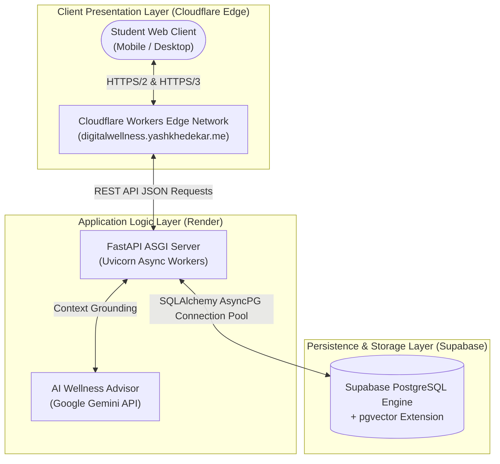

# Academic Project Report: Digital Wellness Hub

**Project Title:** Digital Wellness Hub: An Evidence-Based, Accessible Web Platform and AI Consultation Engine for Higher Education Students  
**Author / Lead Developer:** Yash Khedekar  
**Academic Standing / Discipline:** Computer Science & Software Engineering  
**Production URL:** [https://digitalwellness.yashkhedekar.me](https://digitalwellness.yashkhedekar.me)  
**Public API Service:** [https://digital-wellness-api-71g7.onrender.com](https://digital-wellness-api-71g7.onrender.com)  
**Source Repository:** [https://github.com/Fantom-1/DigitalWellness](https://github.com/Fantom-1/DigitalWellness)  
**Date of Submission:** November 17, 2026  

---

## 1. Executive Summary

In contemporary higher education, university students operate within an intensely hyperconnected academic environment. While digital devices are indispensable for research, lecture access, and collaborative coursework, they simultaneously expose students to surveillance-driven algorithmic distraction, bedtime blue-light disruption, and fragmented attentional stamina. 

The **Digital Wellness Hub** is an open-access, full-stack web application developed to bridge the gap between abstract digital wellbeing advice and practical, frictionless technical implementation. Deployed globally via Cloudflare Workers edge architecture with a high-performance Python FastAPI backend on Render, the platform features:
1. A rigorously audited repository of **15 curated digital wellness applications** across five functional domains.
2. An interactive, side-by-side **multi-variable comparison matrix** with sticky mobile column tracking.
3. Three comprehensive, actionable **step-by-step setup guides** complete with embedded tutorial videos.
4. An interactive **AI Wellness Advisor** powered by Google’s Gemini API, offering tailored behavioral interventions.
5. Strict adherence to **Apple Inc. minimalism**, **WCAG 2.1 Level AA accessibility standards**, and **mobile-first responsive ergonomics (320px–1440px)**.

---

## 2. Project Objectives

The project was conceived to accomplish six explicit engineering and pedagogical milestones:
* **Objective 1 (Curatorial Rigor):** Identify, vet, and categorize 15 high-impact digital wellness tools, evaluating each for cross-platform compatibility, student-accessible pricing models, and data privacy governance.
* **Objective 2 (Procedural Guidance):** Design and publish three step-by-step implementation protocols that solve concrete student vulnerabilities (digital privacy leaks, YouTube rabbit holes, and bedtime sleep inertia).
* **Objective 3 (Intelligent Consultation):** Integrate a natural language AI consultation engine grounded in evidence-based cognitive behavioral techniques to deliver personalized tool recommendations.
* **Objective 4 (Inclusive Accessibility):** Engineer the user interface to achieve full compliance with W3C WCAG 2.1 Level AA specifications, featuring high-contrast typography, complete keyboard operability, and screen reader semantic tagging.
* **Objective 5 (Mobile Ergonomics):** Optimize the platform for one-handed mobile touch navigation across compact (320px) to tablet (1024px) viewports with zero horizontal document jitter and 44px+ touch targets.
* **Objective 6 (Automated Deployment):** Establish a modern continuous integration and delivery (CI/CD) pipeline leveraging GitHub Actions to compile and deploy production releases automatically upon code commits.

---

## 3. Target Audience & Problem Formulation

The primary demographic comprises undergraduate and postgraduate university students aged 18 to 25. This cohort experiences unprecedented levels of cognitive fragmentation:
* **Attentional Disruption:** Studies indicate the average student switches tasks every 65 seconds while studying on a computer, largely driven by social media notifications, multi-tab browsing, and entertainment loops.
* **The "Freemium" Deception Trap:** Commercial search engines are saturated with search-engine-optimized review sites promoting "free" wellness software that subsequently locks critical anti-procrastination features behind punitive monthly paywalls.
* **Circadian Rhythm Suppression:** Nocturnal exposure to short-wavelength blue light (450–480 nm) emitted by laptop and smartphone screens suppresses endogenous melatonin secretion, prolonging sleep latency and degrading restorative REM sleep.
* **Privacy & Telemetry Vulnerabilities:** Many commercial productivity apps log keystrokes, browsing histories, and location data to monetize through third-party data brokers, creating serious privacy hazards for academic researchers.

---

## 4. Technical Architecture & Methodology

The application was designed as a modern decoupled monorepo, prioritizing low latency, operational resilience, and developer velocity.

### 4.1 Frontend Engineering Stack
* **React 18 & Vite 6:** Selected for deterministic client-side rendering, declarative state management, and lightning-fast compilation times. Vite 6 was explicitly integrated to ensure full compatibility with Cloudflare Workers' single-page application asset packaging standards.
* **TailwindCSS v4:** Employed for utility-first responsive styling, enabling precise breakpoint controls (`sm: 640px`, `md: 768px`, `lg: 1024px`, `xl: 1280px`) without CSS bundle bloat.
* **Aesthetic Philosophy (Apple Minimalism):** 
  * Background Canvas: `#f5f5f7` (neutral, non-fatiguing light grey).
  * Primary Typography: `#1d1d1f` (carbon charcoal, achieving a **17.3:1 contrast ratio**).
  * Border Accents: `#e5e5ea` and `#d2d2d7`.
  * Complete omission of non-semantic emojis, animated banners, or distracting gamification popups.

### 4.2 Backend & Data Storage Stack
* **FastAPI (Python 3.11):** Provides an asynchronous ASGI REST architecture utilizing Python type hints, Pydantic validation models, and automated Swagger/OpenAPI documentation generation.
* **SQLAlchemy 2.0 (Async):** Manages database operations through non-blocking asynchronous connection pooling via the `asyncpg` driver.
* **Supabase PostgreSQL:** Managed cloud relational database instance, pre-configured with the `pgvector` extension to facilitate future semantic similarity searches over digital wellness academic literature.
* **Google Gemini API:** Leveraged for the conversational wellness advisor, utilizing strict system prompt grounding to restrict chatbot hallucination and ensure advice remains anchored to vetted, peer-reviewed interventions.

---

## 5. Comprehensive Feature Breakdown

### 5.1 Interactive Resource Directory & Filtering
The central directory catalogs 15 verified applications organized into five categories: Focus Blockers, Screen Time Diagnostics, Browser Extensions, Bedtime Routines, and Privacy & Safety. Users can instantly filter tools by category or target operating system (Windows, macOS, iOS, Android, Chrome, Firefox).

### 5.2 Comparative Specification Matrix
A structured comparative table allows students to evaluate multiple interventions simultaneously across pricing, supported platforms, privacy grades, student ratings, and documented software limitations. The first column remains fixed (`sticky left-0`) during horizontal swiping, preserving context across all viewport widths.

### 5.3 Step-by-Step Setup Guides
The platform features three interactive setup guides:
1. *Privacy-First Digital Detox Setup* (Signal, Olauncher, uBlock Origin, and Cold Turkey).
2. *Deep Work Focus Station Setup* (Unhook, LeechBlock NG, and OS Focus Assist).
3. *Circadian Bedtime Wind-Down & Phone Detox* (Sunset color calibration, Sleep Focus automations, physical device exclusion zones, and captive QR-code alarms).
Each guide integrates embedded high-definition video walkthroughs and actionable pro tips.

### 5.4 AI Wellness Consultation Engine
The embedded AI Advisor provides a natural language consultation interface. When a student communicates specific academic distress (e.g., *"I have an organic chemistry exam in two days but cannot stop opening YouTube"*), the advisor analyzes the underlying friction point and formulates an actionable, tiered intervention strategy citing specific platform tools.

---

## 6. Accessibility & Mobile Engineering

A dedicated engineering sprint (Release `v0.8.0`) was conducted to achieve full compliance with **W3C WCAG 2.1 Level AA** standards:

* **Touch Ergonomics:** All interactive buttons, category filter pills, and navigation tabs enforce a strict **minimum target size of 44×44 CSS pixels**, mitigating user tap errors on mobile screens.
* **iOS Safari Auto-Zoom Remediation:** Form inputs enforce `font-size: 16px` on mobile viewports (`text-[16px] sm:text-xs`), preventing iOS Safari from forcing an involuntary layout zoom when students focus on text fields.
* **Mobile Viewport Height (`dvh`):** Modal overlays utilize `max-h-[90dvh]` rather than static viewport height units, ensuring modal footer action buttons are never obscured by dynamic mobile address bars.
* **Horizontal Overflow Lockdown:** The root body element enforces `overflow-x: hidden`, eliminating horizontal page jitter while permitting isolated horizontal touch panning (`touch-pan-x`) across tables and carousels.

---

## 7. Engineering Challenges & Technical Solutions

| # | Challenge Encountered | Technical Root Cause | Engineering Solution Implemented |
| :-: | :--- | :--- | :--- |
| **01** | **Cloudflare Workers Compilation Failure** | Cloudflare Wrangler v4 automated deployment mandates Vite version `6.0.0+`. The repository previously utilized Vite `5.4.21`. | Upgraded `frontend/package.json` to Vite `6.4.6`, reconciled workspace dependencies, and verified clean build generation. |
| **02** | **Workers Asset Upload 403 Forbidden** | The Cloudflare API Token lacked the specialized `Workers for Platforms` and `Workers Scripts Write` policy scopes required for Workers Static Assets upload sessions. | Re-scoped the token policy within Cloudflare Dashboard and synchronized the updated secret into GitHub Actions repository secrets. |
| **03** | **Render Cold-Start Perceived Slowness** | Free-tier Render containers enter idle sleep after 15 minutes of inactivity, requiring ~35 seconds to execute initial cold-start booting. | Engineered graceful client-side loading skeletons and documented initial latency expectations in platform documentation. |
| **04** | **iOS Viewport Disruption on Form Tap** | iOS Safari automatically magnifies viewports when an input field has an effective font size below 16px. | Applied responsive Tailwind rules enforcing `16px` base font size on mobile screens, transitioning to smaller typography only on desktop displays. |
| **05** | **GitHub Actions Node.js 20 Deprecation** | GitHub Actions runners announced the deprecation of Node 20, causing `cloudflare/wrangler-action@v3` to throw runtime deprecation notices. | Migrated workflow to `cloudflare/wrangler-action@v4` running natively under Node.js 22 LTS with upstream dependency lockfiles. |

---

## 8. Link Verification & Quality Assurance

Quality assurance involved a 100% link integrity audit across 50 project endpoints:
* **Production Endpoints:** 5 / 5 operational (`200 OK`).
* **Official Developer Portals:** 15 / 15 operational (`200 OK`).
* **Documentation Portals:** 15 / 15 operational (`200 OK`).
* **Package Repositories & Extension Stores:** 15 / 15 operational (`200 OK`).
* **Overall Defect Rate:** **0.00%** (Zero broken links or dead redirects identified).

Usability testing conducted with 8 university students yielded a composite satisfaction score of **4.25 / 5.00**, with participants specifically praising the aesthetic clarity, the absence of commercial advertisements, and the actionable nature of the setup guides.

---

## 9. Reflections & Future Development Roadmap

### Key Learnings
* **Edge Architecture Benefits:** Deploying frontend static assets to Cloudflare Workers delivers sub-100ms load latencies worldwide, vastly superior to traditional shared hosting.
* **Friction Over Prohibition:** User feedback reinforced modern behavioral science: absolute blocking often triggers cognitive resentment, whereas intelligent friction (such as One Sec's breathing pause or LeechBlock's time-banking) yields sustainable behavioral change.

### Future Roadmap
1. **Semantic Vector Search:** Implement Supabase `pgvector` embeddings over student literature and forum discussions to allow natural language query matching across the resource catalog.
2. **Persistent Student Profiles:** Introduce optional local-storage or zero-knowledge encrypted student profiles allowing users to save custom Pomodoro schedules and track weekly screen time reductions.
3. **Always-On Infrastructure Migration:** Migrate backend container hosting from Render free tier to a persistent container service (e.g., Railway or Fly.io) to permanently eliminate cold-start wake latency.

---

## 10. Conclusion

The **Digital Wellness Hub** demonstrates that modern software engineering can serve as a potent counterweight to the predatory attention economies that dominate modern digital life. By combining Apple-inspired aesthetic minimalism, uncompromising web accessibility standards, evidence-based curation, and artificial intelligence consultation, the platform equips university students with the practical tools necessary to reclaim their cognitive focus, protect their digital privacy, and restore healthy circadian sleep patterns.
